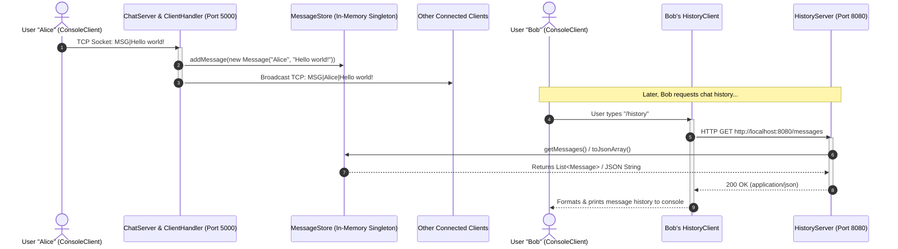

# Campus Collaboration Hub – Integration & Technical Specification Document

**Project:** Network Programming – Assignment 02  
**Focus:** HTTP REST API Server, Client History Retrieval, and Shared Message Store Integration  
**Associated Members:** Member 1 (TCP & Client Integration), Member 3 (HTTP / REST API)

---

## 1. Overview & Objective

The **Campus Collaboration Hub** integrates five fundamental networking protocols into a cohesive distributed system. A central requirement is demonstrating interoperability between distinct protocols:

1. **Protocol 1 (TCP):** Handles real-time, bidirectional chat streaming (`ChatServer` & `ChatClient` on port `5000`).
2. **Protocol 3 (HTTP/REST):** Exposes message history via stateless REST endpoints (`HistoryServer` & `HistoryClient` on port `8080`).

This document details the architecture, code integration, thread management, and data flow across three critical components:
1. **HistoryServer into `Main.java`**
2. **HistoryClient into the `/history` console command**
3. **TCP Chat Messages into the shared `MessageStore`**

---

## 2. System Architecture & Component Interaction



---

## 3. Deep Dive: Component Implementations

### 3.1. HistoryServer into `Main.java`

#### Purpose
`Main.java` orchestrates all server-side daemon processes. In addition to launching the TCP Chat Server on port 5000, it must spin up the HTTP History Server on port 8080 without blocking the main execution thread.

#### Architectural Role
* Uses Java's built-in lightweight HTTP server: `com.sun.net.httpserver.HttpServer`.
* Exposes standard REST endpoints (e.g., `GET /messages` and `GET /messages?limit=N`).
* Binds to `Config.REST_HTTP_PORT` (Port 8080).
* Shuts down gracefully through a JVM Shutdown Hook.

#### Integration Code in `Main.java`

```java
// Inside Main.java

import http.HistoryServer;

public class Main {
    private static ChatServer chatServer;
    private static HistoryServer historyServer; // Reference for lifecycle management

    public static void main(String[] args) {
        // ... (Store initializations) ...

        // -------------------------------------------------------------
        // Component 3: HTTP REST API Server (Member 3 - Pasindu)
        // -------------------------------------------------------------
        historyServer = new HistoryServer(Config.REST_HTTP_PORT);
        historyServer.start();
        System.out.println("[Main] HTTP REST History Server launched on port " + Config.REST_HTTP_PORT);

        // -------------------------------------------------------------
        // Graceful Shutdown Hook
        // -------------------------------------------------------------
        Runtime.getRuntime().addShutdownHook(new Thread(() -> {
            System.out.println("\n[Main] Shutdown signal received. Stopping servers...");
            if (chatServer != null) {
                chatServer.stop();
            }
            if (historyServer != null) {
                historyServer.stop();
            }
            System.out.println("[Main] All servers stopped cleanly.");
        }));
    }
}
```

#### HistoryServer Implementation Blueprint (`http/HistoryServer.java`)

```java
package http;

import com.sun.net.httpserver.HttpServer;
import com.sun.net.httpserver.HttpHandler;
import com.sun.net.httpserver.HttpExchange;
import common.Config;
import common.MessageStore;

import java.io.IOException;
import java.io.OutputStream;
import java.net.InetSocketAddress;
import java.nio.charset.StandardCharsets;
import java.util.concurrent.Executors;

public class HistoryServer {
    private final int port;
    private HttpServer server;

    public HistoryServer(int port) {
        this.port = port;
    }

    public void start() {
        try {
            server = HttpServer.create(new InetSocketAddress(port), 0);
            
            // Route: GET /messages
            server.createContext("/messages", new MessagesHandler());
            
            // Thread pool for handling concurrent HTTP requests
            server.setExecutor(Executors.newFixedThreadPool(10));
            server.start();
            System.out.println("[HistoryServer] Listening on http://localhost:" + port + "/messages");
        } catch (IOException e) {
            System.err.println("[HistoryServer] Failed to start on port " + port + ": " + e.getMessage());
        }
    }

    public void stop() {
        if (server != null) {
            server.stop(1); // 1 second graceful delay
            System.out.println("[HistoryServer] Stopped.");
        }
    }

    static class MessagesHandler implements HttpHandler {
        @Override
        public void handle(HttpExchange exchange) throws IOException {
            if ("GET".equalsIgnoreCase(exchange.getRequestMethod())) {
                String responseJson = MessageStore.getInstance().toJsonArray();
                byte[] responseBytes = responseJson.getBytes(StandardCharsets.UTF_8);

                exchange.getResponseHeaders().set("Content-Type", "application/json; charset=UTF-8");
                exchange.sendResponseHeaders(200, responseBytes.length);

                try (OutputStream os = exchange.getResponseBody()) {
                    os.write(responseBytes);
                }
            } else {
                // Method Not Allowed
                exchange.sendResponseHeaders(405, -1);
            }
        }
    }
}
```

---

### 3.2. HistoryClient into the `/history` Command

#### Purpose
`ConsoleClient.java` must demonstrate real network protocol execution. Even though developers running both client and server locally *could* read `MessageStore` directly from RAM, doing so violates network isolation principles. The client must dispatch a real **HTTP GET** request across the network.

#### Implementation Workflow
1. User enters `/history`.
2. `ConsoleClient` routes the input to `handleHistoryCommand()`.
3. `HistoryClient` dispatches `GET http://<host>:8080/messages` via Java 11's modern `java.net.http.HttpClient`.
4. The JSON array response is parsed into `List<Message>` and printed formatted.

#### HistoryClient Implementation Blueprint (`http/HistoryClient.java`)

```java
package http;

import common.Config;
import common.Message;

import java.io.IOException;
import java.net.URI;
import java.net.http.HttpClient;
import java.net.http.HttpRequest;
import java.net.http.HttpResponse;
import java.time.Duration;
import java.util.ArrayList;
import java.util.List;

public class HistoryClient {
    private final String baseUrl;
    private final HttpClient httpClient;

    public HistoryClient(String host, int port) {
        this.baseUrl = "http://" + host + ":" + port;
        this.httpClient = HttpClient.newBuilder()
                .connectTimeout(Duration.ofSeconds(5))
                .build();
    }

    public List<Message> fetchHistory() throws IOException, InterruptedException {
        HttpRequest request = HttpRequest.newBuilder()
                .uri(URI.create(baseUrl + "/messages"))
                .header("Accept", "application/json")
                .timeout(Duration.ofSeconds(5))
                .GET()
                .build();

        HttpResponse<String> response = httpClient.send(request, HttpResponse.BodyHandlers.ofString());

        if (response.statusCode() == 200) {
            return parseJsonToMessages(response.body());
        } else {
            throw new IOException("Server returned HTTP " + response.statusCode());
        }
    }

    /**
     * Parses simple JSON array of messages without requiring heavy external dependencies.
     */
    private List<Message> parseJsonToMessages(String json) {
        List<Message> list = new ArrayList<>();
        if (json == null || json.trim().isEmpty() || json.equals("[]")) {
            return list;
        }

        // Lightweight parser matching Message.toJson() format
        String content = json.trim();
        if (content.startsWith("[") && content.endsWith("]")) {
            content = content.substring(1, content.length() - 1).trim();
        }

        String[] messageObjects = content.split("(?<=\\}),\\s*(?=\\{)");
        for (String obj : messageObjects) {
            String sender = extractField(obj, "sender");
            String text = extractField(obj, "text");
            String timestamp = extractField(obj, "timestamp");
            list.add(new Message(sender, text, timestamp));
        }
        return list;
    }

    private String extractField(String json, String field) {
        String key = "\"" + field + "\":\"";
        int start = json.indexOf(key);
        if (start == -1) return "";
        start += key.length();
        int end = json.indexOf("\"", start);
        return (end != -1) ? json.substring(start, end) : "";
    }
}
```

#### Updated `handleHistoryCommand()` in `ConsoleClient.java`

```java
// Inside ConsoleClient.java

private final HistoryClient historyClient = new HistoryClient(Config.DEFAULT_HOST, Config.REST_HTTP_PORT);

private void handleHistoryCommand() {
    System.out.println("\n--- [Message History via HTTP REST API] ---");
    try {
        List<Message> history = historyClient.fetchHistory();
        if (history.isEmpty()) {
            System.out.println("(No messages recorded yet)");
        } else {
            for (Message msg : history) {
                System.out.println(msg.toString());
            }
        }
    } catch (Exception e) {
        System.err.println("[ConsoleClient] Failed to fetch history via HTTP: " + e.getMessage());
        System.out.println("(Ensure HistoryServer is running on port " + Config.REST_HTTP_PORT + ")");
    }
    System.out.println("-------------------------------------------\n");
}
```

---

### 3.3. TCP Chat Messages into the Shared `MessageStore`

#### The Cross-Protocol Bridge Problem
* **TCP Chat:** Runs on a stateful, long-lived bidirectional socket stream (`ServerSocket`). Messages are ephemeral data streams.
* **HTTP History:** Runs on a stateless, request-response architecture. It has no persistent socket to the chat clients.

To allow the HTTP API to serve messages that were transmitted over TCP, both protocols access a **shared thread-safe memory model**: `MessageStore`.

```
                    ┌─────────────────────────┐
                    │  tcp.ClientHandler      │
                    │  (Worker Thread)        │
                    └───────────┬─────────────┘
                                │ addMessage()
                                ▼
                   ┌───────────────────────────┐
                   │   common.MessageStore     │
                   │  (CopyOnWriteArrayList)   │
                   └───────────▲───────────────┘
                                │ getMessages() / toJsonArray()
                    ┌───────────┴─────────────┐
                    │  http.HistoryServer     │
                    │  (HTTP Worker Thread)   │
                    └─────────────────────────┘
```

#### Thread-Safety Considerations
Because multiple `ClientHandler` threads write concurrently while multiple `HistoryServer` threads read concurrently:
* `MessageStore` uses `java.util.concurrent.CopyOnWriteArrayList`.
* Reads (`getMessages()`, `toJsonArray()`) are lock-free and never suffer from `ConcurrentModificationException`.
* Appends are atomic and safe across thread pools.

#### Code in `tcp/ClientHandler.java`

```java
// Inside ClientHandler.java message loop:

if (line.startsWith("MSG|")) {
    String chatText = line.substring(4);

    // 1. Persist to shared store for HTTP REST retrieval
    Message message = new Message(username, chatText);
    MessageStore.getInstance().addMessage(message);

    // 2. Real-time broadcast over TCP to all connected peers
    server.broadcast("MSG|" + username + "|" + chatText);
    System.out.println("[ChatServer] [" + username + "]: " + chatText);
}
```

---

## 4. Verification and Testing

### 1. Verification of HTTP Server (`curl`)
While `Main.java` is running and clients have exchanged messages, test the REST API directly from the command line:

```bash
curl -i http://localhost:8080/messages
```

**Expected Response:**
```http
HTTP/1.1 200 OK
Content-Type: application/json; charset=UTF-8

[{"sender":"Alice","text":"Hello everyone!","timestamp":"2026-11-25 09:20:00"}]
```

### 2. End-to-End Workflow Test
1. Start server: `java -cp out Main`
2. Launch Client A: `java -cp out ConsoleClient`  
   - Enter: `/login Alice pass123`  
   - Send: `Hello from Alice!`
3. Launch Client B: `java -cp out ConsoleClient`  
   - Enter: `/login Bob pass123`  
   - Enter: `/history`
4. Confirm Bob receives Alice's message formatted from the HTTP response.
