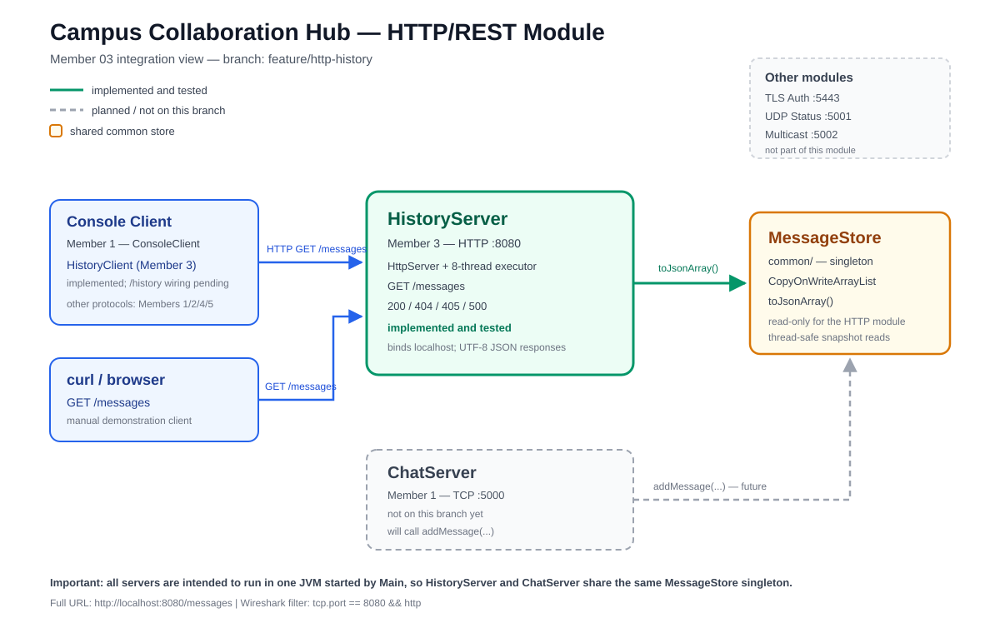

# Member 03 — HTTP/REST Message History API

**Project:** Campus Collaboration Hub  
**Assignment:** Network Programming — Assignment 02  
**Member:** Pasindu (Member 03)  
**Branch:** `feature/http-history`  
**Module status:** HTTP server and client implemented and tested. **38 of 38 automated checks passed** on Java 17.0.21.1. Full TCP-to-HTTP integration is still pending Member 01's `ChatServer`.

> This document describes the code that actually exists in `src/main/java/http/` and `src/test/java/http/`.
> Wireshark instructions are prepared but **no packet capture was performed** on this machine because Wireshark, Npcap and tshark were not found on PATH or in their standard install locations. See [wireshark-demo.md](wireshark-demo.md).

## Contents

1. [Introduction to HTTP and REST](#1-introduction-to-http-and-rest)
2. [Purpose of the Message History API](#2-purpose-of-the-message-history-api)
3. [System architecture](#3-system-architecture)
4. [HistoryServer implementation](#4-historyserver-implementation)
5. [HttpServer explanation](#5-httpserver-explanation)
6. [MessageStore integration](#6-messagestore-integration)
7. [HistoryClient implementation](#7-historyclient-implementation)
8. [HttpClient explanation](#8-httpclient-explanation)
9. [REST endpoint documentation](#9-rest-endpoint-documentation)
10. [HTTP methods and status codes](#10-http-methods-and-status-codes)
11. [Request and response headers](#11-request-and-response-headers)
12. [JSON response structure](#12-json-response-structure)
13. [Error handling](#13-error-handling)
14. [Concurrent request handling](#14-concurrent-request-handling)
15. [Testing methodology and actual results](#15-testing-methodology-and-actual-results)
16. [curl testing](#16-curl-testing)
17. [Browser testing](#17-browser-testing)
18. [Wireshark demonstration instructions](#18-wireshark-demonstration-instructions)
19. [Limitations and future integration requirements](#19-limitations-and-future-integration-requirements)

**Supporting documents**

- [Wireshark demonstration runbook](wireshark-demo.md)
- [Detailed code explanation](code-explanation.md)
- [Testing evidence and full results](testing-results.md)
- [Two-minute presentation speech](presentation.md)
- [Live demonstration script](demo-script.md)
- [Lecturer viva questions and answers](viva-questions.md)
- [Screenshot checklist](screenshots-checklist.md)
- [Architecture diagram (SVG)](architecture.svg)
- [Architecture diagram (PNG)](architecture.png)

---

## 1. Introduction to HTTP and REST

### 1.1 HTTP

**HTTP (Hypertext Transfer Protocol)** is an application-layer request-response protocol. A client opens a TCP connection to a server, sends a request with a method, a path, headers and optionally a body, and the server sends a response with a status code, headers and optionally a body.

Important properties:

- **Application layer:** HTTP runs on top of TCP. TCP provides reliable, ordered bytes; HTTP defines what those bytes mean.
- **Stateless:** each request is independent. The server does not need to remember previous requests. Our `/messages` request contains everything needed to answer it.
- **Text-based headers:** HTTP headers are human-readable, which makes the protocol easy to inspect in curl and Wireshark.
- **Status codes:** the server reports the result in a standard way, for example `200 OK`, `404 Not Found`, `405 Method Not Allowed` and `500 Internal Server Error`.

A typical HTTP/1.1 request:

```http
GET /messages HTTP/1.1
Host:localhost:8080
User-Agent: curl/8.22.0
Accept: application/json

```

A typical response:

```http
HTTP/1.1 200 OK
Content-type: application/json; charset=UTF-8
Content-length: 147

[{"sender":"alice","text":"Hello everyone","timestamp":"2026-11-25 08:55:11"}]
```

### 1.2 REST

**REST (Representational State Transfer)** is an architectural style, not a protocol. A REST-style API:

- models data as **resources** identified by URIs;
- uses standard HTTP methods (`GET`, `POST`, `PUT`, `DELETE`);
- is **stateless**;
- transfers a **representation** of the resource, commonly JSON.

Our API is deliberately small and read-only:

```text
GET /messages
```

`/messages` is the resource — the collection of chat messages. `GET` means "read this resource without changing it". The representation is a JSON array. This is REST-style: resource-oriented, stateless, standard method, standard status codes, JSON representation.

### 1.3 Why HTTP/REST for message history?

- Any browser, curl or Java client can test it without a custom protocol.
- It cleanly separates history reads from the real-time chat flow.
- Standard status codes make success and failure unambiguous.
- HTTP is already built into Java (`HttpServer`, `HttpClient`), so no external dependency is needed.
- It is easy to demonstrate in Wireshark because HTTP/1.1 is unencrypted and readable on port 8080.

---

## 2. Purpose of the Message History API

The Chat Server (Member 01) is designed to write every chat message into the shared in-memory `MessageStore`. Once integrated, the HTTP module exposes that history to clients:

```text
Chat Server  --addMessage()-->  MessageStore  --toJsonArray()-->  HistoryServer  --HTTP GET-->  HistoryClient
```

The API:

- is **read-only** — it never adds, edits or deletes messages;
- returns the **real** messages stored by the application, not a separate demo list;
- produces a **JSON array** with the existing `sender`, `text` and `timestamp` fields;
- lets the console client display history through a future `/history` command;
- can be tested independently with curl or a browser.

No separate message database was created. This is important: the REST API and the chat server must see the same data.

---

## 3. System architecture



A PNG version is available for slides: [architecture.png](architecture.png).

### 3.1 Components

| Component | Member | Port / protocol | Status on this branch |
|---|---|---:|---|
| `AuthServer` / `AuthClient` | 4 | 5443 / TLS over TCP | Not implemented yet |
| `ChatServer` / `ChatClient` | 1 | 5000 / TCP | Not implemented yet |
| `StatusNotifier` / `StatusListener` | 2 | 5001 / UDP | Not implemented yet |
| **`HistoryServer` / `HistoryClient`** | **3** | **8080 / HTTP** | **Implemented and tested** |
| `AnnouncementSender` / `AnnouncementListener` | 5 | 5002 / Multicast | Not implemented yet |
| `SessionStore` | shared | in-memory | Implemented in `common/` |
| `MessageStore` | shared | in-memory | Implemented in `common/` |

### 3.2 Data flow for history

1. When the TCP chat server is integrated, it receives a message from a client over TCP.
2. Member 01's chat server will call `MessageStore.getInstance().addMessage(...)`.
3. A client sends `GET /messages` over HTTP to port 8080.
4. `HistoryServer` reads `MessageStore.getInstance().toJsonArray()`.
5. The JSON array is returned with status `200 OK`.
6. `HistoryClient` (or curl/browser) displays the JSON.

### 3.3 One-process requirement

The README architecture states that all server components run inside **one Java process** started by `Main`. That is essential here: `MessageStore` is an in-memory singleton, so the chat server and HTTP server must be in the **same JVM** to share it.

If the HTTP server were started as a separate process, it would have its own empty `MessageStore` and would never see chat messages. This is the main integration constraint for Member 01.

### 3.4 Current integration state

`Main.java` currently has a TODO for `http.HistoryServer` but does not start it. `ConsoleClient.java` only lists `/history` in its help text; it has no command loop yet. Per the approved rules, neither file was modified. The smallest integration changes are shown in [section 19](#19-limitations-and-future-integration-requirements).

---

## 4. HistoryServer implementation

**File:** `src/main/java/http/HistoryServer.java`

### 4.1 Responsibilities

- Create and configure a `com.sun.net.httpserver.HttpServer`.
- Bind `Config.DEFAULT_HOST` on `Config.REST_HTTP_PORT` (8080).
- Expose exactly one endpoint: `GET /messages`.
- Read history from the shared `MessageStore`.
- Return JSON with correct headers and status codes.
- Reject unknown paths with 404 and unsupported methods with 405.
- Handle internal failures with 500.
- Shut down cleanly.

### 4.2 Lifecycle

| Method | Line | Purpose |
|---|---:|---|
| `HistoryServer()` | 47 | Uses `Config.REST_HTTP_PORT` (8080) |
| `HistoryServer(int port)` | 55 | Test/alternative port; port `0` asks the OS for a free port |
| `start()` | 64 | Binds the socket, installs contexts and executor, starts accepting |
| `stop()` | 100 | Stops the server, closes the listening socket, shuts down the executor |
| `getPort()` | 125 | Actual bound port after start, or configured port before start |
| `getBaseUrl()` | 130 | Builds `http://localhost:<port>` from `Config.DEFAULT_HOST` |
| `main()` | 243 | Standalone demonstration entry point |

`start()` wraps a bind failure in an `IOException` that names the host and port. This makes a port conflict understandable instead of showing a bare `BindException`.

### 4.3 Request routing

Two contexts are registered:

```java
newServer.createContext(MESSAGES_PATH, new MessagesHandler());
newServer.createContext("/", new NotFoundHandler());
```

`HttpServer` matches contexts by **longest prefix**, not by exact path. That means `/messages/extra` would also be routed to the `/messages` context. To enforce the contract, `MessagesHandler.handle()` checks:

```java
if (!MESSAGES_PATH.equals(path)) {
    sendError(exchange, 404, "Not Found", "Unknown endpoint: " + path);
    return;
}
```

The root context catches every other path and returns 404. This gives exact endpoint matching while still using the required `/messages` context.

### 4.4 Method validation

The handler accepts only `GET`:

```java
if (!"GET".equals(exchange.getRequestMethod())) {
    exchange.getResponseHeaders().set("Allow", "GET");
    sendError(exchange, 405, "Method Not Allowed", ...);
    return;
}
```

The `Allow: GET` header is part of correct HTTP behaviour for a 405 response: it tells the client which methods the resource supports.

### 4.5 Response writing

`sendJson()`:

- converts the JSON string to bytes with `StandardCharsets.UTF_8`;
- sets `Content-Type: application/json; charset=UTF-8`;
- sets `Cache-Control: no-store` because history changes;
- sets `X-Content-Type-Options: nosniff`;
- calls `sendResponseHeaders(status, bytes.length)`, which also sets `Content-Length`;
- writes the body through a try-with-resources `OutputStream`.

`exchange.close()` is called in a `finally` block so the exchange is released even if writing fails. This is explicit resource management.

### 4.6 Error handling

- Unknown path → 404 with JSON body.
- Wrong method → 405 with JSON body and `Allow: GET`.
- Runtime failure while building history → 500 with JSON body.
- Bind failure → clear `IOException` from `start()`.

A malformed HTTP request (for example an invalid request line) is rejected by the JDK's HTTP parser before our handler runs; the application does not need to parse raw HTTP itself.

### 4.7 Testability seam

`buildHistoryJson()` is `protected`:

```java
protected String buildHistoryJson() {
    return MessageStore.getInstance().toJsonArray();
}
```

The test harness overrides it to throw an exception, which proves the 500 path without modifying `common.MessageStore`. In production the method simply reads the real store.

### 4.8 Standalone entry point

`HistoryServer.main()` starts the server on 8080 and keeps the process alive with a `CountDownLatch`. A shutdown hook calls `stop()`. This lets Member 03 demonstrate the module before `Main.java` integration.

---

## 5. HttpServer explanation

`com.sun.net.httpserver.HttpServer` is a lightweight HTTP/1.1 server included with the JDK in the `jdk.httpserver` module. It is not a full application server (no servlet container, no WAR deployment), but it is sufficient for this assignment and requires no external dependency.

### 5.1 Server creation and binding

```java
HttpServer server = HttpServer.create(
        new InetSocketAddress(Config.DEFAULT_HOST, configuredPort), 0);
```

- `InetSocketAddress` combines host and port.
- The second argument is the backlog (0 means the system default).
- Binding to `localhost` means the server is reachable only from this machine. That suits the assignment's `http://localhost:8080` URL and avoids exposing history on the network.

### 5.2 Contexts and handlers

- `HttpContext` maps a path prefix to an `HttpHandler`.
- The longest matching prefix wins.
- `HttpHandler.handle(HttpExchange)` runs for each request.
- `HttpExchange` exposes the request method, URI, headers, request body, response headers and response body.

### 5.3 Executor and concurrency

`HttpServer` has no executor by default; handlers then run on the dispatcher thread, effectively serializing requests. This implementation sets:

```java
Executors.newFixedThreadPool(8, daemonThreadFactory)
```

The dispatcher accepts connections and the pool runs up to eight handlers concurrently. Additional requests wait in the pool's queue. Daemon threads do not prevent JVM exit; the server's own dispatcher keeps the process alive while it is running.

### 5.4 Request/response lifecycle

1. Client connects over TCP.
2. Server parses the HTTP request.
3. Dispatcher selects the longest matching context.
4. Executor invokes the handler.
5. Handler calls `sendResponseHeaders(status, length)`.
6. Handler writes the body to `getResponseBody()`.
7. Handler closes the exchange; the connection may be reused for another request (HTTP/1.1 keep-alive) or closed.

### 5.5 Shutdown

`HttpServer.stop(delay)` closes the listening socket and waits up to `delay` seconds for active exchanges. This implementation calls `stop(1)` and then `shutdownNow()` on the executor. Calling `stop()` twice is safe because the method returns immediately when `server` is already `null`.

---

## 6. MessageStore integration

`common/MessageStore` is a thread-safe, in-memory singleton:

```java
private static final MessageStore INSTANCE = new MessageStore();
private final List<Message> messages = new CopyOnWriteArrayList<>();

public static MessageStore getInstance() { ... }
public void addMessage(Message message) { ... }
public List<Message> getMessages() { ... }
public String toJsonArray() { ... }
```

### 6.1 Why `CopyOnWriteArrayList`?

- Chat handlers can add messages while HTTP handlers read them.
- Writes create a new internal array; readers keep using the old consistent array.
- Iteration (including the stream in `toJsonArray()`) sees a stable snapshot, so a response cannot contain half of a message or fail with `ConcurrentModificationException`.
- The trade-off is that every write copies the array. That is acceptable for a demonstration-scale chat history. A production system with very large history would use a different storage strategy.

### 6.2 JSON generation

`toJsonArray()`:

```java
return "[" + messages.stream()
        .map(Message::toJson)
        .collect(Collectors.joining(",")) + "]";
```

`Message.toJson()` produces:

```json
{"sender":"alice","text":"Hello everyone","timestamp":"2026-11-25 08:55:11"}
```

The existing serializer escapes backslash, double quote, backspace, form feed, newline, carriage return and tab. The timestamp uses `yyyy-MM-dd HH:mm:ss` in the system time zone. This is the actual format; it is **not** ISO-8601 with a `T` separator.

### 6.3 What was not changed

- No new message collection was created.
- `common/MessageStore` and `common/Message` were not modified.
- The HTTP module only calls the existing public API.

---

## 7. HistoryClient implementation

**File:** `src/main/java/http/HistoryClient.java`

### 7.1 Responsibilities

- Send `GET http://localhost:8080/messages` with `java.net.http.HttpClient`.
- Apply connection and request timeouts.
- Accept only HTTP 200.
- Return the JSON body for reuse.
- Print history in the console.
- Report connection, timeout, HTTP and interruption failures clearly.

### 7.2 Important methods

| Method | Line | Purpose |
|---|---:|---|
| `defaultMessagesUrl()` | 49 | Builds `http://localhost:8080/messages` from `Config` |
| `HistoryClient()` | 34 | Uses the default URL |
| `HistoryClient(String)` | 42 | Explicit URL for tests or alternative hosts |
| `fetchHistory()` | 61 | Performs the request, checks status, returns the body |
| `printHistory()` | 83 | Console-friendly wrapper with error messages |
| `main()` | 102 | Standalone client demonstration |

`fetchHistory()` builds an immutable request:

```java
HttpRequest.newBuilder(messagesUri)
        .timeout(Duration.ofSeconds(10))
        .header("Accept", "application/json")
        .GET()
        .build();
```

and sends it with:

```java
httpClient.send(request,
        HttpResponse.BodyHandlers.ofString(StandardCharsets.UTF_8));
```

If the status is not 200, it throws an `IOException` that includes the status and response body. This means callers cannot accidentally treat a 404 or 500 as valid history.

### 7.3 Exception handling in `printHistory()`

The catch order matters because several exceptions are subclasses of `IOException`:

1. `ConnectException` — server is not running or connection refused.
2. `HttpTimeoutException` — connect or request timeout.
3. `IOException` — other HTTP/network/status errors.
4. `InterruptedException` — restore the interrupt flag and report the interruption.

The client is kept independent of `ConsoleClient` as approved. Member 01 can call it from a `/history` command later.

---

## 8. HttpClient explanation

`java.net.http.HttpClient` is the modern HTTP client introduced in Java 11. It is part of the JDK and supports HTTP/1.1 and HTTP/2.

### 8.1 Construction

```java
HttpClient.newBuilder()
        .connectTimeout(Duration.ofSeconds(5))
        .build();
```

`HttpClient` is immutable and thread-safe; one instance can be reused for many requests. The connect timeout limits TCP connection establishment. The per-request timeout (10 seconds here) limits the whole exchange after the request is sent.

### 8.2 Request and body handling

- `HttpRequest` is immutable; `newBuilder(...)` creates a builder.
- `.GET()` sets the method.
- `.header("Accept", "application/json")` tells the server which representation the client wants.
- `BodyHandlers.ofString(StandardCharsets.UTF_8)` reads the entire response body and decodes it with UTF-8.

### 8.3 Status handling

`HttpClient` does not throw an exception just because the status is 404 or 500. The caller must inspect `response.statusCode()`. `fetchHistory()` does exactly that and rejects anything other than 200.

### 8.4 Resource management

`HttpClient` manages its own connection pool and executor. In Java 17 it is not `AutoCloseable`, so there is no `close()` call. The client object can be reused and is eligible for garbage collection when no longer referenced.

---

## 9. REST endpoint documentation

### 9.1 `GET /messages`

| Item | Value |
|---|---|
| Method | `GET` |
| URL | `http://localhost:8080/messages` |
| Request body | None |
| Success status | `200 OK` |
| Success body | JSON array of message objects |
| Content-Type | `application/json; charset=UTF-8` |
| Other methods | `405 Method Not Allowed` with `Allow: GET` |
| Unknown path | `404 Not Found` |
| Internal error | `500 Internal Server Error` |

### 9.2 Success example

Request:

```http
GET /messages HTTP/1.1
Host: localhost:8080
Accept: application/json
```

Response:

```http
HTTP/1.1 200 OK
Content-type: application/json; charset=UTF-8
Content-length: 147
Cache-control: no-store
X-content-type-options: nosniff

[{"sender":"alice","text":"Hello everyone","timestamp":"2026-11-25 08:55:11"},{"sender":"bob","text":"Hi Alice","timestamp":"2026-11-25 08:55:11"}]
```

### 9.3 Empty history

After `MessageStore.clear()` and before any chat message is added:

```json
[]
```

Status is still `200 OK`. An empty collection is not an error.

### 9.4 Exact matching

| Path | Result |
|---|---|
| `/messages` | 200 (GET) or 405 (other methods) |
| `/messages/extra` | 404 |
| `/messagesfoo` | 404 |
| `/unknown` | 404 |

Query strings are ignored for routing; `/messages?limit=10` still matches the endpoint, and this implementation returns all messages because pagination is not implemented.

### 9.5 Error example

```json
{"status":404,"error":"Not Found","message":"Unknown endpoint: /unknown"}
```

---

## 10. HTTP methods and status codes

### 10.1 Methods used

| Method | Meaning | Our use |
|---|---|---|
| `GET` | Read a resource; safe and idempotent | `GET /messages` |
| `POST` | Submit data / create a resource | Rejected with 405 |
| `PUT` | Replace a resource | Rejected with 405 |
| `DELETE` | Delete a resource | Rejected with 405 |

`GET` is **safe** because it does not change server state, and **idempotent** because repeating it produces the same logical result. This API is read-only, so GET is the only correct method.

### 10.2 Status codes returned

| Status | Reason | When |
|---:|---|---|
| `200 OK` | Request succeeded | `GET /messages` returned the array |
| `404 Not Found` | No resource at that path | `/unknown`, `/messages/extra` |
| `405 Method Not Allowed` | Resource exists, method unsupported | POST/PUT/DELETE on `/messages` |
| `500 Internal Server Error` | Server failed while building the response | Simulated serialization failure |

Why 405 rather than 404 for `POST /messages`? The resource `/messages` exists; the method is what is unsupported. The `Allow: GET` header makes the correct method explicit. Returning 404 would wrongly tell the client the resource does not exist.

---

## 11. Request and response headers

### 11.1 Request headers

| Header | Typical value | Meaning |
|---|---|---|
| Request line | `GET /messages HTTP/1.1` | Method, path, HTTP version |
| `Host` | `localhost:8080` | Target host and port |
| `User-Agent` | `curl/8.22.0` or `Java-http-client/17.0.21.1` | Client identification |
| `Accept` | `application/json` | Representation the client prefers |

### 11.2 Response headers

| Header | Value | Purpose |
|---|---|---|
| `Content-Type` | `application/json; charset=UTF-8` | Body is JSON encoded in UTF-8 |
| `Content-Length` | byte count | Exact body length; set by `sendResponseHeaders(status, length)` |
| `Cache-Control` | `no-store` | History changes; do not cache stale responses |
| `X-Content-Type-Options` | `nosniff` | Stop browsers from guessing a different content type |
| `Allow` | `GET` | Sent only on 405 responses |
| `Date` | e.g. `Wed, 25 Nov 2026 03:25:11 GMT` | Added by the HTTP server; GMT, not local time |

`Content-Type` describes **what the body is**. `Accept` describes **what the client wants**. They are different headers with different directions.

---

## 12. JSON response structure

### 12.1 Shape

The body is a JSON **array**. Each element is an object:

```json
[
  {
    "sender": "alice",
    "text": "Hello everyone",
    "timestamp": "2026-11-25 08:55:11"
  },
  {
    "sender": "bob",
    "text": "Hi Alice",
    "timestamp": "2026-11-25 08:55:11"
  }
]
```

The server actually returns compact JSON on one line; it is shown formatted here for readability.

### 12.2 Fields

| Field | JSON type | Source | Example |
|---|---|---|---|
| `sender` | string | `Message.getSender()` | `"alice"` |
| `text` | string | `Message.getText()` | `"Hello everyone"` |
| `timestamp` | string | `Message.getFormattedTimestamp()` | `"2026-11-25 08:55:11"` |

The timestamp format is `yyyy-MM-dd HH:mm:ss` in the system time zone. It is a JSON string, not a number or a nested object.

### 12.3 Escaping and encoding

`Message.toJson()` escapes:

- backslash → `\\`
- double quote → `\"`
- backspace → `\b`
- form feed → `\f`
- newline → `\n`
- carriage return → `\r`
- tab → `\t`

The HTTP layer converts the final string to UTF-8 bytes and declares UTF-8 in `Content-Type`. The test harness includes a message containing a quote, a backslash, a newline and a tab, and verifies the escaped form appears in the response.

`common.Message` is the project's existing serializer; it is not a full JSON library. It does not escape every possible Unicode control character. For normal console chat text this is acceptable, and the HTTP module deliberately reuses it rather than introducing a second serialization scheme.

### 12.4 Empty and concurrent states

- No messages → `[]`.
- Messages added during a read → the reader sees a consistent snapshot, not a partial list (see section 14).

---

## 13. Error handling

### 13.1 Server-side error responses

| Scenario | Status | Body |
|---|---:|---|
| Unknown path | 404 | `{"status":404,"error":"Not Found","message":"Unknown endpoint: /..."}` |
| Unsupported method | 405 | `{"status":405,"error":"Method Not Allowed","message":"POST is not supported for /messages"}` + `Allow: GET` |
| Runtime failure | 500 | `{"status":500,"error":"Internal Server Error","message":"Could not build message history"}` |
| Port already in use | — | `start()` throws `IOException` with host, port and reason |

The 500 is tested by overriding the protected `buildHistoryJson()` method in a test subclass so it throws. That exercises the real handler and response code without changing shared classes. In normal operation the method only reads `MessageStore`.

### 13.2 Client-side error handling

| Failure | Client behaviour |
|---|---|
| Connection refused | Catches `ConnectException`, prints "Is HistoryServer running?" |
| Connect/request timeout | Catches `HttpTimeoutException` |
| Non-200 status | `fetchHistory()` throws `IOException` with status and body |
| Other I/O failure | Catches `IOException` and prints the message |
| Thread interrupted | Restores the interrupt flag and reports it |

### 13.3 Resource management

- Response body stream: try-with-resources.
- Exchange: closed in `finally`.
- Listener socket and executor: released by `stop()`.
- Client: no manual close required in Java 17; the JDK manages its connection pool.

---

## 14. Concurrent request handling

### 14.1 Server side

`HistoryServer` uses a fixed thread pool of 8 daemon worker threads. Up to eight handlers run simultaneously; more requests wait in the pool queue. Each handler has its own `HttpExchange`, so request state is not shared between handlers.

The only shared state is `MessageStore`. It is a `CopyOnWriteArrayList`, and `toJsonArray()` streams over a snapshot. Therefore:

- a reader never sees a list being modified in place;
- a reader never throws `ConcurrentModificationException`;
- each JSON response is internally consistent;
- different responses may represent different moments in time, which is normal and acceptable.

### 14.2 Test performed

The harness ran:

- 8 reader threads;
- 25 `GET /messages` requests per reader (200 requests total);
- 1 writer thread adding 200 messages concurrently;
- a start gate so readers and writer begin together.

Actual result: all 200 requests returned 200 with a bracket-valid JSON array, the store ended with 200 messages, and the final response exactly matched `MessageStore.toJsonArray()`. No crashes, no 500s, no truncated bodies.

### 14.3 Limitations

- The pool size is fixed at 8. For a larger demo, use `Runtime.getRuntime().availableProcessors()` or a configurable value.
- Each response builds the entire JSON string in memory. Very large histories would need pagination or streaming.
- `CopyOnWriteArrayList` favours read-heavy workloads; write-heavy workloads would pay a copying cost.

---

## 15. Testing methodology and actual results

### 15.1 Method

The project has no Maven/Gradle and no JUnit dependency, so testing uses a plain Java harness with a `main` method:

- compile the real production classes;
- compile the harness separately into `out-test`;
- start a real `HistoryServer` on port `0` (OS-assigned) to avoid conflicts;
- use the real `MessageStore`;
- send real HTTP requests with `java.net.http.HttpClient`;
- print `PASS`/`FAIL` lines and exit with status 1 if anything fails.

Isolated integration vs full integration:

- The HTTP layer is tested end-to-end: real socket, real HTTP request/response, real store.
- Member 01's TCP chat server does not exist on this branch, so messages are inserted directly into the real `MessageStore` by the test. This is clearly **not** a full TCP-chat integration test.
- `HistoryDemoServer` does the same for manual curl/browser/Wireshark demonstrations and is labelled as a test fixture.

### 15.2 Actual result

```text
RESULT: 38 passed, 0 failed
```

Coverage:

| Area | Checks | Result |
|---|---|---|
| Default port 8080 and startup | 2 | PASS |
| Empty history, JSON body, Content-Type | 3 | PASS |
| Real messages, field names, escaping | 7 | PASS |
| 404 unknown endpoint and exact matching | 5 | PASS |
| 405 POST/PUT/DELETE, Allow header, no side effect | 12 | PASS |
| Java `HistoryClient` success | 1 | PASS |
| Connection-refused handling | 1 | PASS |
| Concurrent readers + writer | 3 | PASS |
| Port-conflict startup failure | 1 | PASS |
| Simulated 500 | 3 | PASS |

Full commands and output: [testing-results.md](testing-results.md).

### 15.3 What was not tested

- Full TCP → `MessageStore` → HTTP flow (no `ChatServer` on this branch).
- UDP, TLS and Multicast non-interference (those modules do not exist here yet).
- Wireshark capture (Wireshark/Npcap not found on PATH or standard install locations; manual task).
- Browser visual test on this machine (manual task; instructions provided).

No results are claimed for those items.

---

## 16. curl testing

### 16.1 Start the server

For a seeded demo (test fixture):

```powershell
java -cp "out;out-test" http.HistoryDemoServer
```

For the real module with an empty store:

```powershell
java -cp out http.HistoryServer
```

Build first if needed:

```powershell
javac -d out (Get-ChildItem -Recurse -Filter *.java src/main/java | Select-Object -ExpandProperty FullName)
javac -cp out -d out-test (Get-ChildItem -Recurse -Filter *.java src/test/java | Select-Object -ExpandProperty FullName)
```

### 16.2 Commands and actual observed results

```powershell
curl.exe -sS -i --http1.1 http://localhost:8080/messages
```

Observed:

```text
HTTP/1.1 200 OK
Content-type: application/json; charset=UTF-8
Content-length: 147
X-content-type-options: nosniff
Cache-control: no-store

[{"sender":"alice","text":"Hello everyone","timestamp":"2026-11-25 08:55:11"},{"sender":"bob","text":"Hi Alice","timestamp":"2026-11-25 08:55:11"}]
```

```powershell
curl.exe -sS -i --http1.1 http://localhost:8080/unknown
```

Observed:

```text
HTTP/1.1 404 Not Found
Content-type: application/json; charset=UTF-8
Content-length: 73

{"status":404,"error":"Not Found","message":"Unknown endpoint: /unknown"}
```

```powershell
curl.exe -sS -i --http1.1 -X POST http://localhost:8080/messages
```

Observed:

```text
HTTP/1.1 405 Method Not Allowed
Allow: GET
Content-type: application/json; charset=UTF-8
Content-length: 91

{"status":405,"error":"Method Not Allowed","message":"POST is not supported for /messages"}
```

PUT and DELETE produced equivalent 405 responses. `GET /messages/extra` returned 404.

> The exact `Date`, `Content-length` and timestamp values vary between runs. The values above are from the actual verification run, not invented.

---

## 17. Browser testing

1. Start `http.HistoryDemoServer` (seeded) or the future integrated `Main`.
2. Open `http://localhost:8080/messages` in Chrome, Edge or Firefox.
3. The browser sends `GET /messages` and displays the JSON array.
4. Open `http://localhost:8080/unknown` to see the JSON 404 body.
5. The address bar can only send GET. Use curl, Postman or browser DevTools to demonstrate POST/PUT/DELETE and receive 405.

Expected browser result: the raw JSON array (some browsers pretty-print it). There is no HTML page; this is a data API, not a web UI.

---

## 18. Wireshark demonstration instructions

Full step-by-step runbook: [wireshark-demo.md](wireshark-demo.md).

Required display filter:

```text
tcp.port == 8080 && http
```

Summary:

1. Install Wireshark and Npcap with loopback capture support.
2. Select the loopback interface, not Wi-Fi/Ethernet.
3. Start capture, apply the display filter.
4. Start the server and run the curl commands.
5. Identify `GET /messages HTTP/1.1` and `HTTP/1.1 200 OK`.
6. Expand request headers, response headers and the JSON body.
7. Identify 404 for `/unknown` and 405 for `POST /messages`.
8. Stop and save the capture as `.pcapng`; take the required screenshots.

**Status:** Wireshark, tshark, dumpcap and Npcap were checked on this machine and were **not found on PATH or in their standard install locations**. No capture was performed. Every step in the runbook is a manual task for you.

---

## 19. Limitations and future integration requirements

### 19.1 Current limitations

1. **No ChatServer on this branch.** Full TCP chat → `MessageStore` → HTTP history cannot be demonstrated yet. The HTTP module is tested against the real store with test-injected messages.
2. **Main does not start HistoryServer.** `Main.java` is owned by Member 01. Until it is updated, run `http.HistoryServer` or `http.HistoryDemoServer` separately.
3. **ConsoleClient has no command loop.** `/history` is only help text. `HistoryClient` is ready but not wired in.
4. **In-memory history.** Messages are lost on restart, and the list grows without bound.
5. **No pagination/filtering.** `GET /messages` always returns everything; query strings are ignored.
6. **No authentication on the HTTP endpoint.** It is read-only and bound to localhost, but anyone on the machine can read history.
7. **Plain HTTP.** Traffic on 8080 is not encrypted. TLS on 5443 is for authentication, not for this endpoint. Do not expose this API on an untrusted network.
8. **Hand-written JSON serializer.** `common.Message` escapes common JSON characters but is not a full JSON library.
9. **No automated framework.** The harness is a plain `main`, not JUnit; it is easy to run but less standard.
10. **Single fixed pool size.** Eight threads is adequate for the demo, not a tuned production value.

### 19.2 Smallest integration changes

`Main.java` (Member 01) should start the server and register shutdown:

```java
try {
    http.HistoryServer historyServer = new http.HistoryServer();
    historyServer.start();
    Runtime.getRuntime().addShutdownHook(new Thread(historyServer::stop));
} catch (java.io.IOException e) {
    System.err.println("[HTTP] " + e.getMessage());
}
```

`ConsoleClient.java` (Member 01), once a command loop exists:

```java
if ("/history".equals(line)) {
    new http.HistoryClient().printHistory();
    continue;
}
```

The critical requirement is that `Main` and the chat server run in **one JVM**, so the HTTP handler and the chat handler share the same `MessageStore` singleton.

### 19.3 Future improvements

- Member 01's `ChatServer` calls `MessageStore.getInstance().addMessage(...)`; the HTTP code then works unchanged.
- Add pagination (`?limit=` and `?before=`) with a small extension to the handler.
- Persist history to a file or database if it must survive restart.
- Use HTTPS or auth tokens if the API is exposed beyond localhost.
- Replace the hand-written serializer with a maintained JSON library if the project allows dependencies.
- Add JUnit tests and CI once a build system is introduced.

---

## Appendix A — Files created by Member 03

| File | Purpose |
|---|---|
| `src/main/java/http/HistoryServer.java` | HTTP server, routing, JSON responses, status codes |
| `src/main/java/http/HistoryClient.java` | Java HTTP client and console display |
| `src/test/java/http/HttpHistoryTest.java` | Plain-Java test harness (38 checks) |
| `src/test/java/http/HistoryDemoServer.java` | Seeded demo fixture for curl/browser/Wireshark |
| `docs/member-03-http-rest/README.md` | This document |
| `docs/member-03-http-rest/wireshark-demo.md` | Wireshark runbook |
| `docs/member-03-http-rest/code-explanation.md` | Detailed class/method explanation |
| `docs/member-03-http-rest/testing-results.md` | Test commands and actual output |
| `docs/member-03-http-rest/presentation.md` | Two-minute speech |
| `docs/member-03-http-rest/demo-script.md` | Live demonstration script |
| `docs/member-03-http-rest/viva-questions.md` | Lecturer viva preparation |
| `docs/member-03-http-rest/screenshots-checklist.md` | Manual evidence checklist |
| `docs/member-03-http-rest/architecture.svg` | Architecture diagram (vector) |
| `docs/member-03-http-rest/architecture.png` | Architecture diagram (PNG, ready for slides) |

No existing file owned by another member was modified.

## Appendix B — Quick run commands

```powershell
# Compile production code
javac -d out (Get-ChildItem -Recurse -Filter *.java src/main/java | Select-Object -ExpandProperty FullName)

# Compile tests
javac -cp out -d out-test (Get-ChildItem -Recurse -Filter *.java src/test/java | Select-Object -ExpandProperty FullName)

# Run the automated checks (38 expected)
java -cp "out;out-test" http.HttpHistoryTest

# Run the seeded demo server on port 8080
java -cp "out;out-test" http.HistoryDemoServer

# In a second terminal
curl.exe -sS -i --http1.1 http://localhost:8080/messages
curl.exe -sS -i --http1.1 http://localhost:8080/unknown
curl.exe -sS -i --http1.1 -X POST http://localhost:8080/messages

# Standalone client (with the server running)
java -cp out http.HistoryClient
```

Browser: `http://localhost:8080/messages`

## Appendix C — Related documents

- [Wireshark demonstration runbook](wireshark-demo.md)
- [Detailed code explanation](code-explanation.md)
- [Testing evidence](testing-results.md)
- [Presentation speech](presentation.md)
- [Live demo script](demo-script.md)
- [Viva questions](viva-questions.md)
- [Screenshot checklist](screenshots-checklist.md)
- [Architecture diagram (SVG)](architecture.svg)
- [Architecture diagram (PNG)](architecture.png)
